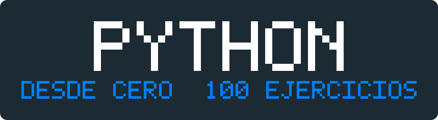
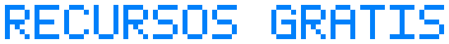

<p align="center">
  
</p>

<h1 align="center">Python desde Cero: 100 Ejercicios con Solución</h1>

<p align="center">
  Cien ejercicios de Python para principiantes, con <b>un ejemplo resuelto antes de cada uno</b><br>
  y la solución oculta hasta que decidas verla.<br>
  Todo corre en el navegador, sin instalar nada.
</p>

<p align="center">
  
  
  
  
</p>

---


### ¿Nunca usaste GitHub? Empieza por aquí 👇

No necesitas cuenta de GitHub, ni instalar Python, ni saber usar `git`. Solo una cuenta de Google.

| | Paso | Qué haces |
|:--:|---|---|
| **1** | **Elige un tema** | En la tabla de abajo, haz clic en el botón  del tema que quieras. Se abre en Google Colab. |
| **2** | **Guarda tu copia** | En Colab: *Archivo → Guardar una copia en Drive*. ⚠️ **Sin este paso tus respuestas se pierden al cerrar la pestaña.** |
| **3** | **Resuelve** | Lee el ejemplo, escribe tu código en la celda vacía y ejecútala con `Shift + Enter`. |
| **4** | **Pide ayuda si la necesitas** | `pista(n)` te orienta. `solucion(n)` te da la respuesta. Úsalas solo después de intentarlo. |


<p align="center">
  <b>¿Primera vez? Haz este notebook de 5 minutos antes que nada:</b><br><br>
  <a href="https://colab.research.google.com/github/Yulianadorami/python-desde-cero-100-ejercicios/blob/main/00_COMO_EMPEZAR.ipynb">
    
  </a>
</p>

> También puedes descargar los notebooks (botón verde **Code → Download ZIP**) y abrirlos en Jupyter o VS Code, si prefieres trabajar en tu computadora.

---


Los temas están ordenados: cada uno usa lo del anterior. Si recién empiezas, hazlos en orden.

| Tema | Contenido | Ejercicios | Abrir |
|:--:|---|:--:|:--:|
| **01** | **Fundamentos**<br><sub>variables, tipos y operadores</sub> | 1–10 | [](https://colab.research.google.com/github/Yulianadorami/python-desde-cero-100-ejercicios/blob/main/01_fundamentos.ipynb) |
| **02** | **Strings**<br><sub>trabajar con texto</sub> | 11–20 | [](https://colab.research.google.com/github/Yulianadorami/python-desde-cero-100-ejercicios/blob/main/02_strings.ipynb) |
| **03** | **Listas y tuplas**<br><sub>guardar muchos valores</sub> | 21–30 | [](https://colab.research.google.com/github/Yulianadorami/python-desde-cero-100-ejercicios/blob/main/03_listas-tuplas.ipynb) |
| **04** | **Diccionarios y sets**<br><sub>datos con etiqueta</sub> | 31–40 | [](https://colab.research.google.com/github/Yulianadorami/python-desde-cero-100-ejercicios/blob/main/04_diccionarios-sets.ipynb) |
| **05** | **Condicionales**<br><sub>tomar decisiones</sub> | 41–50 | [](https://colab.research.google.com/github/Yulianadorami/python-desde-cero-100-ejercicios/blob/main/05_condicionales.ipynb) |
| **06** | **Bucles**<br><sub>repetir sin copiar y pegar</sub> | 51–60 | [](https://colab.research.google.com/github/Yulianadorami/python-desde-cero-100-ejercicios/blob/main/06_bucles.ipynb) |
| **07** | **Funciones**<br><sub>empaquetar tu código</sub> | 61–70 | [](https://colab.research.google.com/github/Yulianadorami/python-desde-cero-100-ejercicios/blob/main/07_funciones.ipynb) |
| **08** | **Comprehensions**<br><sub>bucles en una línea</sub> | 71–80 | [](https://colab.research.google.com/github/Yulianadorami/python-desde-cero-100-ejercicios/blob/main/08_comprehensions.ipynb) |
| **09** | **NumPy**<br><sub>cálculo con arrays</sub> | 81–90 | [](https://colab.research.google.com/github/Yulianadorami/python-desde-cero-100-ejercicios/blob/main/09_numpy.ipynb) |
| **10** | **Pandas**<br><sub>trabajar con tablas</sub> | 91–100 | [](https://colab.research.google.com/github/Yulianadorami/python-desde-cero-100-ejercicios/blob/main/10_pandas.ipynb) |


**Qué NO incluye:** programación orientada a objetos, visualización y machine learning. Eso va en repositorios aparte, para que este se mantenga enfocado en los fundamentos.

---

## 🧩 Cómo es cada ejercicio

Los 100 siguen la misma estructura de tres partes. Nunca te vas a topar con una solución sin haberla pedido: están guardadas codificadas dentro del notebook.

**1. 📖 Ejemplo resuelto** — un problema parecido, explicado paso a paso:

```python
palabra = "banana"
conteo = palabra.count("a")   # .count() cuenta repeticiones
print(conteo)                 # → 3
```

**2. ✏️ Tu turno** — el ejercicio, con la celda lista para escribir:

```python
# EJERCICIO 19
# Cuenta cuántas veces aparece la letra "o" en la frase.
frase = "los datos cuentan historias"

# Escribe tu código aquí:
```

**3. 💡 ¿Atascado?** — ayuda a dos niveles, cuando tú decidas:

```python
pista(19)      # te orienta sin darte la respuesta
solucion(19)   # te muestra la respuesta y por qué funciona
```

Y esto es lo que aparece al ejecutar `solucion(19)`:

```
✅ SOLUCIÓN · Ejercicio 19
────────────────────────────────────────────────────
frase = "los datos cuentan historias"

print(frase.count("o"))
────────────────────────────────────────────────────
📌 POR QUÉ: Contar frecuencias es el corazón del análisis de texto:
   qué palabra se repite más en reseñas, comentarios o encuestas.
```

---

## 🎯 Cómo sacarle provecho

Cuatro reglas que separan *leer* ejercicios de *aprender* a programar:

1. **Intenta antes de mirar.** Equivocarte y corregir es lo que fija el aprendizaje. Leer la solución directo se siente productivo, pero no lo es.
2. **Escribe el código a mano.** Nada de copiar y pegar, ni siquiera para probar.
3. **Si usaste la solución, repite ese ejercicio al día siguiente** desde cero. Entender una solución y poder escribirla son cosas distintas.
4. **Poco y seguido gana.** 20 minutos diarios rinden mucho más que 4 horas un domingo.

> **Ritmo sugerido:** un tema por semana. En 10 semanas tienes bases sólidas de Python y la puerta abierta a análisis de datos.

---


Los ejercicios usan datos pequeños inventados, para que te concentres en la lógica y nada dependa de una descarga. Pero cuando termines los temas 09 y 10, lo mejor que puedes hacer es **aplicar lo aprendido a datos reales**.

Aquí tienes de dónde sacarlos, todos gratis:

| Plataforma | Qué vas a encontrar | Bueno para |
|---|---|---|
| [Kaggle Datasets](https://www.kaggle.com/datasets) | Miles de datasets de todo tipo, con notebooks de otras personas que puedes leer | Empezar: casi todo viene limpio y documentado |
| [Datos Abiertos Perú](https://www.datosabiertos.gob.pe/) | Datos públicos del Estado peruano: salud, educación, economía, transporte | Proyectos con contexto local, que destacan en un portafolio |
| [INEI](https://www.inei.gob.pe/) | Censos, encuestas y estadísticas oficiales del Perú | Análisis demográficos y socioeconómicos |
| [Nasdaq Data Link](https://data.nasdaq.com/) | Series financieras y económicas | Practicar series de tiempo |
| [Yahoo Finance](https://finance.yahoo.com/) (con `yfinance`) | Precios históricos de acciones | Descargar datos reales desde Python en 3 líneas |
| [Our World in Data](https://ourworldindata.org/) | Datos globales sobre clima, salud, población | Datos ya curados, listos para graficar |
| [Banco Mundial](https://datos.bancomundial.org/) | Indicadores de todos los países | Comparaciones entre países |
| [data.gov](https://data.gov/) | Datos públicos de Estados Unidos | Volumen y variedad |
| [UCI ML Repository](https://archive.ics.uci.edu/) | Datasets clásicos de aprendizaje automático | Cuando pases a machine learning |


**Cómo usarlos con lo que aprendiste:** descarga el CSV, súbelo a Colab (panel izquierdo → icono de carpeta → subir) y ábrelo con:

```python
import pandas as pd

df = pd.read_csv("tu_archivo.csv")
print(df.shape)
print(df.head())
print(df.describe())
```

Esas cuatro líneas son exactamente lo que practicaste en el tema 10. A partir de ahí, aplica `groupby`, filtros y columnas nuevas sobre datos de verdad.

---



Recursos gratuitos que vale la pena conocer mientras avanzas:

**Para seguir aprendiendo Python**

- [Documentación oficial de Python en español](https://docs.python.org/es/3/) — la fuente definitiva, mejor de lo que suena
- [Tutorial de Python (W3Schools)](https://www.w3schools.com/python/) — consultas rápidas de sintaxis
- [Real Python](https://realpython.com/) — artículos muy bien explicados (muchos gratuitos)
- [Automate the Boring Stuff](https://automatetheboringstuff.com/) — libro gratis online, ideal para aplicar Python a tareas cotidianas

**Para ciencia de datos**

- [Pandas: guía de 10 minutos](https://pandas.pydata.org/docs/user_guide/10min.html) — el siguiente paso natural después del tema 10
- [Kaggle Learn](https://www.kaggle.com/learn) — micro-cursos gratuitos y prácticos
- [Python Data Science Handbook](https://jakevdp.github.io/PythonDataScienceHandbook/) — libro completo y gratuito sobre NumPy, Pandas y visualización

**Para practicar más**

- [Exercism (track de Python)](https://exercism.org/tracks/python) — ejercicios con mentoría gratuita
- [HackerRank](https://www.hackerrank.com/domains/python) — retos por nivel
- [Codewars](https://www.codewars.com/) — retos cortos, buenos para mantener el ritmo

**Herramientas**

- [Google Colab](https://colab.research.google.com/) — lo que usas aquí
- [Python Tutor](https://pythontutor.com/) — ejecuta tu código paso a paso y te muestra qué pasa en memoria. Impresionante para entender bucles
- [Visual Studio Code](https://code.visualstudio.com/) — cuando quieras pasar a trabajar local

---

## 🤝 Contribuir

¿Encontraste un error, una explicación confusa o un ejercicio que se puede mejorar? Abre un [issue](https://github.com/Yulianadorami/python-desde-cero-100-ejercicios/issues). Toda corrección es bienvenida.

## 📄 Licencia

[MIT](LICENSE) — úsalo, modifícalo y compártelo libremente, incluso para enseñar o en tus propios cursos.


---

<p align="center">
  <sub>Hecho para quienes están aprendiendo ciencia de datos desde cero.<br>
  Si te sirvió, deja una ⭐ — ayuda a que lo encuentren más personas.</sub>
</p>
